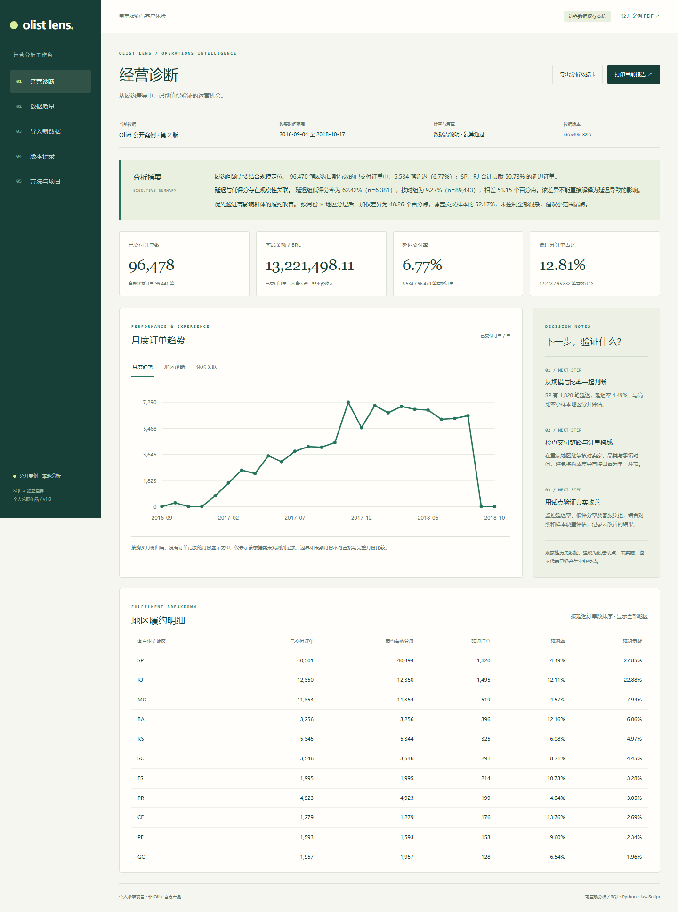

# Olist Lens：电商履约与客户体验诊断

面向电商／运营数据分析岗位的个人作品：真实公开订单分析 + 可重复导入的小工具。公开案例与访客本机数据相互独立。

在线体验：[Olist Lens](https://olist-lens-sy-d2g7eacoh8e6c1fae.webapps.tcloudbase.com) · [案例报告 PDF](output/pdf/olist-case-study.pdf) · [导入模板](output/templates/import-templates-v1.zip) · [数据与计算核验](VALIDATION.md)



本仓库包含可直接运行的静态产品、SQL、分析脚本、报告、模板和测试。原始 Kaggle 数据未随 GitHub 上传，可按下文命令下载并复现。公开部署记录见 [DEPLOYMENT.md](DEPLOYMENT.md)。

## 可以做什么

- 查看经营指标、月度趋势、地区延迟贡献、交付与低评分关联。
- 查看数据质量、缺失覆盖、独立复算及分母；下载分析 JSON 和质量记录。
- 导入标准三张 CSV 与批次说明：预览 → 校验 → SQL / 独立 JavaScript 复算 → 确认切换。
- 在当前浏览器保存完整快照、恢复版本、导出备份 JSON，并从备份重新校验导入。
- 下载正式案例 PDF；打印当前导入版本并另存 PDF，打印内容使用当前数据。

访客文件在 Web Worker 中本地处理，不通过第三方服务、不上传文件内容到服务器；历史版本保存在当前浏览器 IndexedDB。站点静态资源与页面访问仍需网络。浏览器存储可能因配额、无痕模式或清理而不可用，请导出备份。清理站点数据会清除本机历史，不影响公开案例。

## 公开案例的结果与边界

Kaggle Olist v2 共 99,441 笔订单、112,650 条商品明细、99,224 条评价；已交付 96,478 笔。履约有效分母为 96,470 笔，其中 6,534 笔延迟，延迟率 6.77%。

履约和评分均有效的订单中：延迟组 n=6,381，低评分率 62.42%；按时组 n=89,443，低评分率 9.27%。该结果为历史观察性关联，不能解释为因果，也不能声称已取得业务提升。

SQL、独立 JavaScript、Python Decimal 核对核心计数和整数分金额；Python SQLite 额外核对 9 组 SQL 聚合表。校验只能验证已定义规则与计算一致性，不能单独证实源业务事实真实。质量页保留未交付却有交付日期、缺失、无评价等警告。

时间范围来自购买日期 2016-09-04 至 2018-10-17；末期不完整。来源本地时区未知，未假装转换为 UTC。历史巴西业务不代表当前中国市场；商品金额为 BRL，不含运费，不代表平台收入或利润。

## 本地运行

网页运行不需要构建或 npm 安装。使用 Python 3.10+ 的静态服务器：

```powershell
python -m http.server 8787 --bind 127.0.0.1 --directory cloud/dist
```

打开 http://127.0.0.1:8787 。也可运行本目录 `Start.ps1`。直接双击 HTML 可查看公开案例，但 Web Worker 导入需要 HTTP 或 HTTPS。

## 复现公开案例

需要 Node.js 18+、Python 3.10+。数据处理与核验使用 Python 标准库，生成 PDF 另需 `requirements-report.txt`。PDF 默认使用 Windows 微软雅黑；其他系统可通过 OLIST_FONT_REGULAR / OLIST_FONT_BOLD 指定兼容的中文 TrueType 字体文件。浏览器依赖已固定版本打包在 cloud/dist/vendor，含来源和许可。

在项目根目录依次执行：

```powershell
python scripts/download_kaggle.py
python scripts/prepare_case.py
node scripts/analyze.cjs data/canonical/olist-v2 output/analysis/case.json
python scripts/verify_case.py
python scripts/build_case_pdf.py
python scripts/package_release.py
```

首步从 Kaggle 正式接口下载 v2；如果将来接口需要登录，请使用 Kaggle 正式账户流程。原始归档保存在 data/raw/kaggle-v2，记录来源、许可、SHA-256、行数和列；不改写原始 CSV。适配仅映射字段和维度，没有删除或填造业务记录。

`cloud/dist/analysis.sql` 是可读 SQL：商品先按订单汇总，评价按订单窗口排序取最新，再建立订单事实视图。`scripts/verify_case.py` 直接从 CSV 读取，使用 Decimal 与独立循环核对核心指标，并在单独 Python SQLite 中核对聚合表。分析代码不依赖当前网页显示值。

## 测试与项目结构

```powershell
node --test tests/core.test.cjs
```

覆盖同日交付、零分母、多商品、多评价、金额精度、重复、主键冲突、孤儿记录、非法日期／金额／评分和空模板。可选浏览器验收脚本 `scripts/qa_product.cjs` 记录了原开发环境的 Playwright 与 Edge 路径，在其他环境使用前需调整这两处路径，并先启动上述 HTTP 服务、下载与适配案例数据，再以 `WRITE_FIXTURE=1` 运行核心测试生成合成导入样本。核心测试无需安装 Playwright。测试与验证结果见 [QA_NOTES.md](QA_NOTES.md)。

- cloud/dist：可直接部署的静态产品、Worker、SQL、固定依赖及公开案例快照。
- scripts：下载、适配、分析、独立核对、PDF、打包与验收。
- tests：明确标注为合成数据的边界测试。
- notebooks：阅读与复算伴随文件；不把静态截图当作计算证据。
- output/analysis：可审查的分析与质量 JSON。
- output/pdf：正式报告及早期设计样板。
- output/templates：标准空白模板与使用说明。
- data：本地原始数据、规范化输入；不会随站点部署公开整个目录。

## 导入契约

版本 v1.0.0，完整快照模式。必须提交 orders.csv、order_items.csv、order_reviews.csv 和 dataset_manifest.json。金额按整数分计算，空评分不当作好评，空交付日期不进入延迟分母。文件合计最多 80 MB、每张 CSV 最多 400,000 行；错误记录明细最多保留 1,000 条，但汇总持续计数。

订单表主键唯一；商品明细键为 order_id + order_item_id；评价记录键为 review_id + order_id。相同记录键且全部内容相同的重复，按已说明规则去重并留下日志；冲突键阻断。没有通过检查与独立复算的候选版本无法切换。备份恢复重新验证原始文件，不信任备份内存储的计算值。

第一版不支持增量合并、跨币种换算、多来源跨时区混合、多人共享编辑或服务端保存访客文件。新增业务状态需要先明确映射；不自动猜测业务含义。

## 求职讲述

简历描述建议：基于 Olist 公开 99,441 笔订单搭建电商履约诊断工具，使用多表 SQL 与独立 Python 核对核心指标，分析地区延迟贡献及低评分关联，并实现浏览器本地 CSV 校验、完整快照导入、版本恢复及公开网页展示。

面试顺序：业务问题 → 指标分母与关联粒度 → 质量问题 → 观察结果与分层复查 → 试点建议 → 因果与历史数据局限。不要写成任职 Olist 或已经实现业绩提升。

## 数据与第三方许可

来源：[Brazilian E-Commerce Public Dataset by Olist / Kaggle](https://www.kaggle.com/datasets/olistbr/brazilian-ecommerce)，第 2 版，许可 CC BY-NC-SA 4.0。原始数据和衍生数据分析遵循该许可，用于非商业作品展示。

Papa Parse 5.7.0、sql.js 1.15.1 采用 MIT，许可与 npm 包完整性记录保存在 cloud/dist/vendor。产品设计参考见 TOOL_REFERENCES.md。
