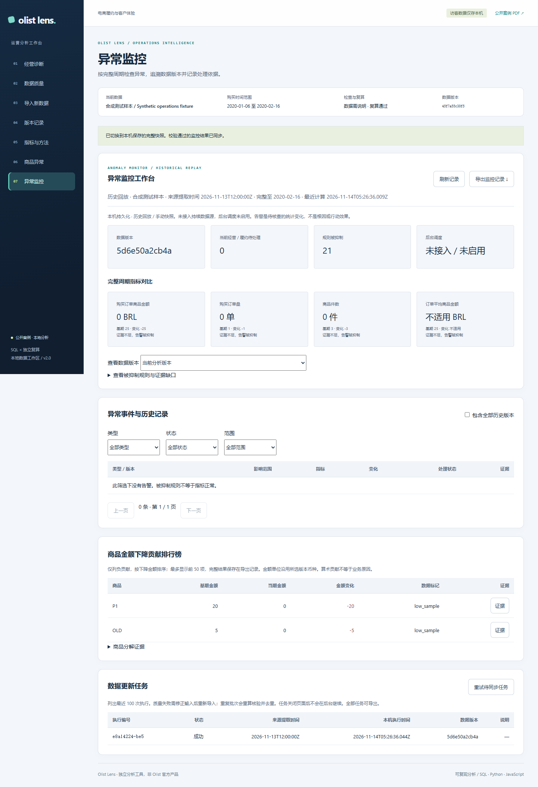
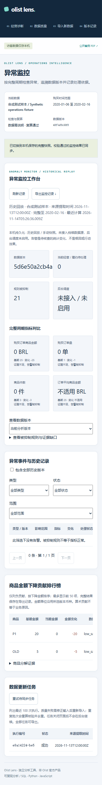

# 第二阶段监控引擎专项审计与验收

日期：2026-11-14（Asia/Shanghai）。审计基线：GitHub `b83f119`、腾讯云 `olist-lens-007`。修复版本：2.0.1，监控计算版本 `monitoring-2.0.1`；购买指标契约保持 `operations-2.0.0`。

## 执行顺序与结论

先审计指定的 8 个文件，并检查相邻的 app.js、CLI 和既有测试；保存测试前审计记录；重跑原 33 项单元/接口测试、12 + 14 项浏览器场景；再添加边界测试，记录失败；最后修复并重新验收。没有跳过失败复现，也没有以真实 Olist 单一历史数据调整默认阈值。

原有测试全通过，但新增测试发现原覆盖缺口：初始 10 项专项单元测试中 6 项失败、4 项通过；初始 5 项浏览器故障场景中 3 项失败、2 项通过。这些失败对应下表 9 个可复现问题。补充精确均值证据与升级兼容测试后，最终单元/接口测试 **44/44** 通过，浏览器 **34/34** 通过（原 12 + 第二阶段 14 + 本轮 8）。

## 发现的问题与修复

| 编号 | 复现问题 | 修复与复验 |
|---|---|---|
| A01 | 无购买订单时，monitor-ui 先将 null 除以 100，显示 0 BRL | 缩放前保留 null；浏览器验证平均订单商品金额为“不适用”，真实零金额仍为 0 |
| A02 | ready 等待 IndexedDB 时取消更新，旧异步回调仍显示候选 | 每个异步检查点重新核对执行编号；回调只处理自己的 Worker；取消后候选、按钮和版本保持正确 |
| A03 | 经营 SQL 与独立 JS 不一致时，虽然无新告警，仍提供确认切换 | 计算/对账失败提升为整批候选阻断；保留上一有效快照；分别注入经营 SQL 和基础 SQL 错误验证 |
| A04 | 延迟率 20%→30% 被浮点减法算成略小于 10 个百分点，阈值相等未触发 | 使用 BigInt 有理数计算派生值、变化、median/MAD 和门槛比较；不改变绝对/相对阈值、MAD 系数及严格/包含边界定义 |
| A05 | monitoring=true/string/array 等非法结构被当作默认配置；对象形式的成熟度证据被转成字符串 | 非法配置类型和履约声明字段类型显式阻断；合法缺证据仍是“证据不足”，不是伪造成熟度 |
| A06 | 监控计算修订生成新 run_id，但完整快照 ID 仍相同 | v2 完整快照 ID 绑定原 operations 快照与 monitoring run；同步事件 snapshot ID；v1 身份算法不改 |
| A07 | 发布入口未校验任务与证据包的数据/运行/快照 ID 一致 | 发布前验证三重绑定，错配时拒绝且不修改记录 |
| A08 | verified 包内混入另一个数据版本的事件，入口仍接受 | 校验事件的数据/运行/快照/规则/指标版本、触发标记与复算证据引用 |
| A09 | 重复 createJob ID 能覆盖此前执行历史 | 拒绝已存在的任务 ID，原状态与历史保持不变 |

另外对已修改的发布路径做防御性加固：提交期间阻止竞争导入/恢复；恢复任务时实际尝试获取该任务的 Web Lock，并在获取锁后重读已保存快照，避免以过时的锁列表或快照列表判断任务。对应提交中恢复、刷新中断和跨标签页场景通过；这些加固不额外计作已复现的 9 个问题。

## 指标与算法审计

`operations.sql` 先按订单和期间筛选，再汇总商品行；没有连接评价表计算经营金额。全店订单直接计数，维度订单采用 COUNT(DISTINCT order_id)。不同维度以及多组订单数不能相加当作全店订单数。

独立合成样本有多商品订单和同订单多评价：基期 2 单、5 件、2803 分，当期 2 单、5 件、7104 分；金额变化 4301 分。商品/品类/卖家/地区四个维度分别与全店变化对账。新增/消失商品的数量、价格效应为 null，构成效应等于金额变化；持续商品数量与价格效应使用精确有理数恒等式检查。

`operations.js`、`operations.sql`、`operations-ui.js` 和原 `core.js`、`analysis.sql`、`snapshot.js`、`tests/core.test.cjs` 保持原字节。金额仍为整数分，未将购买商品金额混同于旧“已交付订单商品金额”或实际净 GMV。

监控派生均值/比例的展示值仍是数字，同时新增 exact 分子分母。例：100/3 分与 200/7 分的均值差精确为 -100/21 分。历史 median/MAD 和阈值比较同样使用精确分数，不是通过添加宽松容差“让测试通过”。历史窗口只取基期之前的完整周期。

## 测试覆盖

| 项目 | 测试与实际结果 |
|---|---|
| 绝对/相对门槛 | 分别测试未达标、刚好相等、严格低于、正负变化和不变；全部符合契约 |
| median/MAD | 独立已知历史序列验证中位数/MAD；正常波动抑制，零 MAD 仍要求其他条件齐备 |
| 样本与完整性 | 基线不足、历史样本低、当期样本低、零基数、缺维度、缺成熟度分别有明确抑制原因 |
| 生命周期 | 新事件、重复运行、历史修订、处理中/关闭/重开、关闭结论和证据必填、完整处理历史 |
| 质量门禁 | 非法评分、非法配置、期间不完整、基础/经营 SQL 失配不会发布新经营事件 |
| 失败恢复 | 读取阶段取消、ready 阶段取消、保存失败、监控事务失败恢复、保存前刷新中断 |
| 版本一致性 | 计算修订生成独立完整快照；错误发布绑定拒绝；旧快照与事件历史保留 |
| 升级兼容 | 用保留的 007 代码生成明确标记的合成 IndexedDB 记录；新版本可读取旧记录，已关闭事件不重置，再分析产生新快照 |
| 全流程 | 上传→校验→计算→检测→确认→发布→详情→处理→导出，真实 Edge/Worker/IndexedDB |
| 设备布局 | 1440/768/390/320 像素；专项空分母截图另外覆盖 1440/390/320 |

本机和浏览器测试使用合成输入。公开历史案例只做读取和下载回归，没有写入合成样本。真实完整 Olist CSV 当前不在本工作副本内；本轮没有重新执行真实全量导入、生产规模压测或异常误报率回测。

## 证据与复现

- 单元测试：`npm test`，44 项。新增 `tests/monitoring-audit.test.cjs` 11 项，原基础 core 测试原样保留。
- 浏览器：`npm run test:browser`；需要安装 Playwright Core/Edge，并先设置 WRITE_FIXTURE=1 执行原 core 测试生成合成导入文件。
- 新浏览器脚本：`scripts/qa_monitoring_audit.cjs`；升级样本：`tests/fixtures/synthetic-monitoring-007.json`，内部 is_synthetic=true。
- 完整机器记录：`output/analysis/monitoring-audit-results.json`、`monitoring-audit-browser.json` 和 `monitoring-audit-unit.txt`。
- 失败记录与修复前截图另保存在本次本地交付目录，避免只保留“全绿”结果。

工作台完整流程与证据截图沿用本轮重新生成的第二阶段验收截图，见 [第二阶段验收](V2_STAGE2_ACCEPTANCE.md)。

## 当前边界与下一阶段建议

当前由人工上传 CSV 触发校验重算。后台定时任务尚未实现，只有禁用调度的接口契约；任务、告警、人工处理记录仅存当前浏览器。现有证据问答是确定性逻辑，不是实际 LLM。历史回放不代表实时经营监控。测试通过不代表真实业务改善。

下一阶段建议顺序：
1. 获取合规真实完整快照与提供者完整性证明，复验真实数据关联、缺失、成熟度和历史修订；不要替缺失的广告、搜索、库存、退款数据填值。
2. 在分离的历史训练/验证周期上评估规则与误报，不根据单一 Olist 历史数据调整阈值以追求好看结果。
3. 有持续数据源后再实现持久化服务端队列、采集、调度、身份权限、幂等与告警云端存储；本轮不声称已实现。
4. AI 下一阶段只读取已验证事件与证据，继续保留证据不足、反证假设和人工审核门禁。

发布与线上验证详见 [MONITORING_AUDIT_RELEASE.md](MONITORING_AUDIT_RELEASE.md)。
