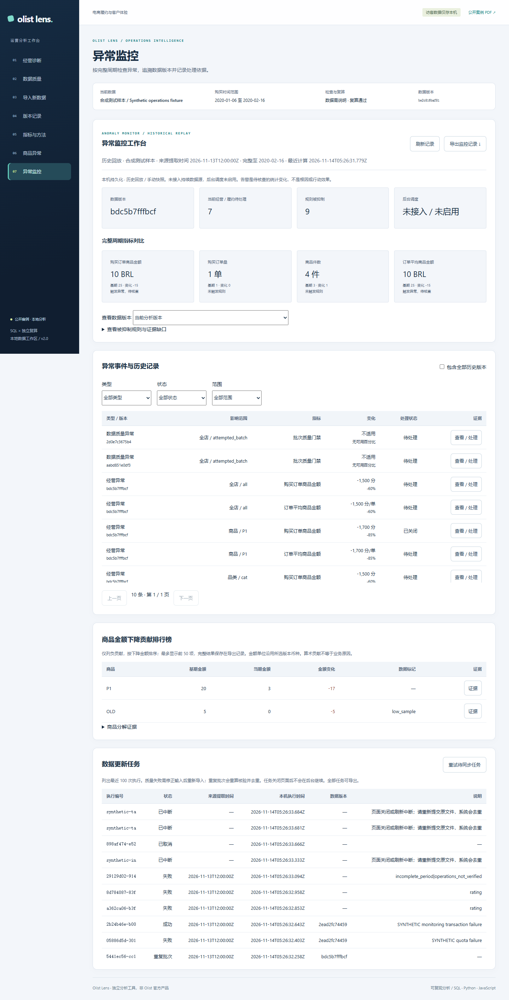
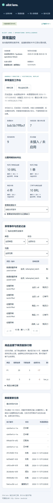
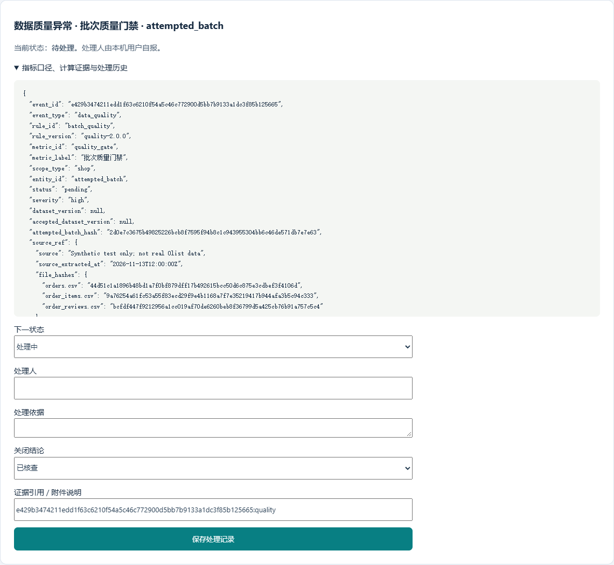

> 本文件记录 2.0.0 / olist-lens-007 的阶段性交付。后续 2.0.1 专项审计见 [MONITORING_AUDIT.md](MONITORING_AUDIT.md)。

# 第二阶段验收记录

日期：2026-11-14（Asia/Shanghai）。所有新增输入均为明确标注的合成样本；不代表真实 Olist 经营表现、异常数量或改善效果。

## 本地结果

- 单元与接口测试：33 / 33 通过（原 core 7、第一阶段 operations 15、第二阶段监控 10、调度接口 1）。
- 原浏览器验收：12 / 12 通过，包括原报告下载、Worker 导入、重复导入、错误门禁、备份重算、版本恢复、原证据复核流程。
- 第二阶段浏览器验收：14 / 14 通过；控制台页面错误 0，业务文件上传请求 0。
- 1440、768、390、320 像素宽度无页面横向溢出；宽表在表格容器内滚动。
- 8 个受保护旧文件与基线逐字节相同，包括 core、analysis.sql、snapshot、原单元测试、公开分析 JSON、两份 PDF 和旧导入模板。

## 验收映射

| 要求 | 实际测试 |
|---|---|
| 新数据触发校验/重算 | 真实 Worker 与 CLI 同一合成输入生成相同 run_id/evidence_hash，确认前监控数据库无运行 |
| 失败不覆盖上一有效版本 | 非法评分、完整性不足、注入快照存储失败；检查当前版本与监控运行数量 |
| 同批不重复告警 | 同批重复导入、行重排、完全重复行；已有关闭状态与处理历史保持 |
| 历史修订可追踪 | 新数据版本、revision_of、旧事件与证据并存 |
| 发布恢复 | 注入监控事务失败，显示待同步；重开核对已提交快照并补发 |
| 四个经营维度 | 全店、商品、品类、卖家各自历史序列及金额/订单/件数/订单均额 |
| 数据边界 | 低样本、零基数、缺 ID、缺历史、非法阈值、缺完整周期有抑制/阻断原因 |
| 履约 | 合成已终结 cohort 的延迟率 0→1、分母 1→1；缺交付日期时抑制，百分比基数为零不编造增长率 |
| 来源与证据 | 文件哈希、代码/指标/规则/数据版本、SQL 说明、完整性声明、分母与历史序列 |
| 人工处理 | 拒绝空处理依据/空关闭证据，保存处理人、状态与历史；刷新后仍为关闭 |
| 监控 UI | 历史/类型/状态过滤、负贡献排行榜、详情、导出与恢复对应版本 |
| 中断与并发 | 页面重开后无执行者的任务标中断；另一标签页的活跃任务不误伤；两个事务写入均保留 |
| 服务端接口 | 无凭证 401、未知来源 404、非法 cron 400、缺适配器拒绝启用 409、配置版本冲突 409、无队列任务接口 503 |

## 功能截图（合成样本）







截图样本中，两个完整周商品金额为 25→10 BRL；P1 贡献 -17、OLD -5、NEW +7，合计 -15 BRL。此处仅用于验收算术、排序、证据及工作流，不能用于经营决策。

## 复现

Node.js 22+，`npm test` 无需下载依赖，使用仓库内已打包的 CSV 与 SQLite WASM。浏览器测试另需 Playwright Core 和 Edge/Chromium：

```powershell
npm test
$env:WRITE_FIXTURE='1'
node --test tests/core.test.cjs
$env:LENS_PLAYWRIGHT_MODULE='<installed playwright-core module directory>'
$env:LENS_BROWSER_EXECUTABLE='<Edge or Chromium executable>'
npm run test:browser
```

测试记录位于 `output/analysis/v2-stage2-unit-tests.txt`、`v2-browser-qa.json`、`v2-monitoring-qa.json`。可设置 `LENS_LIVE_BASE` 运行第二阶段线上浏览器回归，测试在新浏览器上下文内进行，合成 CSV 留在浏览器本机。

## 验收边界

真实完整 CSV 缺失，因此未重新导入全量 Olist 数据，也未做真实异常回测、规模负载测试或误报率评估。原公开历史快照、报告和文件回归已执行。云端任务队列、定时拉数、外部通知、多人云数据库和 AI 助手不在本阶段实现；可运行的调度配置接口没有部署为公开服务。

发布版本与线上核验结果单独记录在 [V2_STAGE2_RELEASE.md](V2_STAGE2_RELEASE.md)。
